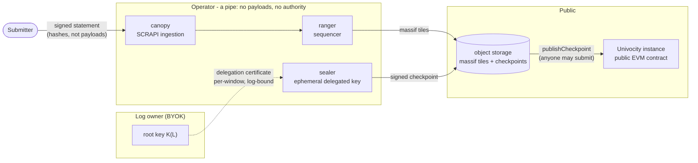
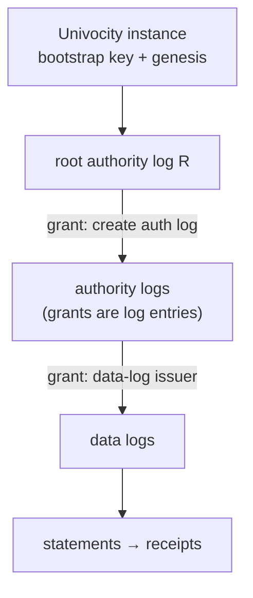
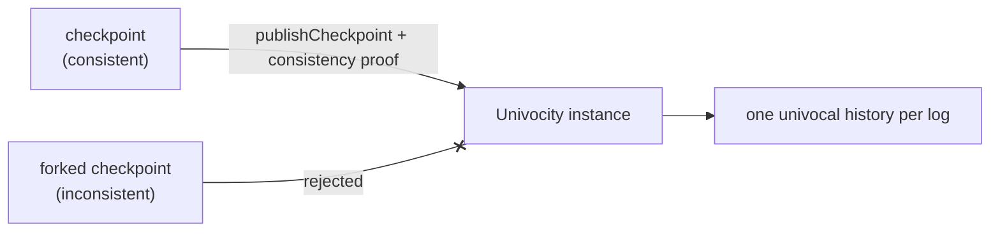

# Forestrie architecture

Forestrie is a custody‑free transparency ledger: the operator never holds
your keys, your payloads, or your history.

The design reduces to four commitments:

1. **The operator is a pipe** — it sequences and stores, but holds no payloads
   and no signing authority.
2. **Everything the log produces is immediately public** — tiles and
   checkpoints are readable, unauthenticated, the moment they are written.
3. **Authorization is log content** — "SCITT built using SCITT": the right to
   write to a log is itself a hierarchy of signed, receipted statements.
4. **Split‑view protection is software** — a registered Univocity contract on
   a public chain, not operator good behaviour, guarantees a single history —
   and instances can exit and re‑register elsewhere at will.

---

## 1. The operator is a pipe

Statements carry content hashes, never content. And while the operator's
services sequence entries and produce checkpoints, the authority to sign
checkpoints belongs to the log owner's key — `K(L)`, a key the owner brings
and keeps (BYOK). The owner signs only short‑lived **delegation
certificates**: log‑bound, range‑bound grants of signing to an ephemeral key
the sealer holds in memory. Decline to renew the delegation and the operator
can sequence nothing further in your name.

Anyone may carry a checkpoint to the chain: the contract verifies the proof
and the signature chain and never checks `msg.sender`. Publishing is a
*postmark, not a gatekeeper* — so the operator is fungible. Many logs and
many Univocity instances can share one operator, and switching is trivial.

## 2. Immediately public

All massif tiles (`.log`) and checkpoints (`.sth`) are written to publicly
readable storage — no authentication, no operator in the read path. Receipts
are *derivable from the data*: hold the tile containing your leaf plus a
checkpoint and you can mint a receipt offline, byte‑identical to one issued
by the API. The API is a convenience, not an authority.

This is what makes the exit story real: the last massif tile plus the
on‑chain checkpoint history is everything needed to keep issuing and
verifying receipts forever, with nothing further from the operator.

## 3. Grant‑based authority — SCITT built using SCITT

SCITT requires a transparency service to authorize what it registers.
Forestrie implements that authorization out of SCITT itself: a **grant** is a
COSE‑signed statement, registered in an **authority log**, receipted, and
verified with the very same offline verifier as any data entry. The access
control plane is not bespoke and not hidden — it is transparent, auditable
log content.

Authority is hierarchical: each forest has one root authority log, bound to
its Univocity instance by key at genesis; grants in authority logs create
child authority logs and authorize issuers on data logs. Grants are bounded
(they expire by index exhaustion), so revocation is simply non‑renewal.

## 4. Split‑view protection is software

A transparency log can self‑certify almost everything — except that it shows
everyone the same history. Forestrie externalises exactly that one guarantee
to a contract: a **Univocity instance** on a public EVM chain accepts a new
checkpoint only with a valid consistency proof against the accumulator state
it already holds. An operator cannot present different views to different
parties, because only one view can ever advance on chain.

Registration is not custody. A Univocity instance is just software plus
public data: an operator hosting one vouches for payment, never for your
trust anchor. An instance owner can exit at any time — deploy their own
contract (self‑serve, at a deterministic address), carry their massifs and
proven history with them, and re‑register with another operator or run the
whole pipeline themselves. Residual trust is small and explicit: your own
log key, the Univocity contract, and the public chain — never the operator.

---

## Component map

| Element | Repository |
|:--|:--|
| SCRAPI ingestion, grant registration, delegation coordination | [canopy](https://github.com/forestrie/canopy) |
| Sequencing (ranger), checkpoint signing (sealer), anchoring | [arbor](https://github.com/forestrie/arbor) |
| Split‑view protection contracts | [univocity](https://github.com/forestrie/univocity) |
| BYOK instance management: operator console, delegation, provisioning | [mandate](https://github.com/forestrie/mandate) |
| Single‑binary participant CLI | [forestrie-cli](https://github.com/forestrie/forestrie-cli) |
| Independent replication and offline verification | [veracity](https://github.com/forestrie/veracity) |
| Core MMR ledger format | [go-merklelog](https://github.com/forestrie/go-merklelog) |

The ledger format and receipt profile are specified in
[draft-bryce-cose-receipts-mmr-profile](https://www.ietf.org/archive/id/draft-bryce-cose-receipts-mmr-profile-00.html),
a profile of
[draft-ietf-cose-merkle-tree-proofs](https://www.ietf.org/archive/id/draft-ietf-cose-merkle-tree-proofs-16.html).
See the [roadmap](./roadmap.md) for where this is going.
